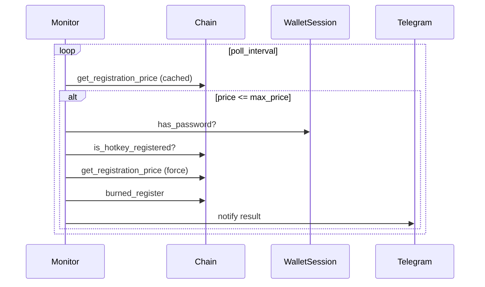

# Architecture & Implementation Plan

## Goal

A reliable multi-user Telegram bot that monitors Bittensor subnet registration (burn) prices and automatically submits registration transactions when a user-defined price threshold is met.

## Requirements Analysis

### Core user flows

1. **Wallet lifecycle** — create, import (mnemonic/ZIP), list, unlock, create hotkeys
2. **Order lifecycle** — create registration order, monitor price, auto-register, cancel
3. **Isolation** — each Telegram `user_id` has separate wallet directory, DB rows, and session state

### Non-functional requirements

| Requirement | Approach |
|-------------|----------|
| Multi-user isolation | `data/users/{user_id}/wallets/` + DB `user_id` column + `UserWalletSessionManager` |
| No password persistence | In-memory `WalletSessionManager` per user; cleared on restart |
| Duplicate order prevention | `OrderRepository.has_active_duplicate()` + app-level check |
| Concurrent tx prevention | `WalletSessionManager.signing()` lock + `_registering` set per (user, coldkey, hotkey) |
| Failure handling | `classify_registration_failure()` → retry or mark FAILED |
| Order persistence | SQLite `orders` table |
| Efficient RPC | `SubnetPriceCache` with configurable TTL (default 1s) |
| Extensible orders | `OrderType` enum + typed params (`SubnetRegistrationParams`) + parser registry |
| Safe logging | `SensitiveDataFilter` redacts password/mnemonic patterns |

## Layered Architecture

```
┌─────────────────────────────────────────────────────────┐
│  Telegram Handlers (commands, wizards, callbacks)       │
├─────────────────────────────────────────────────────────┤
│  Services (WalletService, OrderService)                   │
├──────────────┬────────────────────┬─────────────────────┤
│ Wallet Layer │ Chain Layer        │ Database Layer      │
│ - manager    │ - ChainService     │ - SQLite + repos    │
│ - session    │ - price/reg RPC    │                     │
│ - discovery  │                    │                     │
├──────────────┴────────────────────┴─────────────────────┤
│  Monitor (OrderMonitorCoordinator + SubnetPriceCache)   │
└─────────────────────────────────────────────────────────┘
```

### Handler layer (`sn_reg_bot/handlers/`)

- Thin Telegram adapters; no business logic
- Conversation state in `context.user_data`
- Password/mnemonic messages deleted immediately

### Service layer (`sn_reg_bot/services/`)

- **WalletService** — orchestrates wallet ops with user scoping
- **OrderService** — validates ownership, creates orders, triggers monitor

### Wallet layer (`sn_reg_bot/wallet/`)

- **WalletManager** — filesystem ops scoped to one user directory
- **WalletSessionManager** — per-user unlock cache and signing mutex
- **UserWalletSessionManager** — factory ensuring sessions never cross users

### Chain layer (`sn_reg_bot/chain/`)

- Wraps `SubtensorInterface` with reconnect logic
- Registration via `burned_register_extrinsic` with slippage + price re-check
- Hotkey status via `get_netuids_for_hotkey`

### Monitor layer (`sn_reg_bot/monitor/`)

- One async task per active order
- Before register: check unlocked → check already registered → re-fetch price → submit
- `SubnetPriceCache` deduplicates price RPC across orders on same subnet

### Database layer (`sn_reg_bot/database/`)

- SQLite with `users` and `orders` tables
- Order params stored as JSON for extensibility

## Order Model (Extensible)

```python
OrderType.SUBNET_REGISTRATION → SubnetRegistrationParams(
    netuid, coldkey_name, hotkey_name, max_price_tao
)
```

Future types add a new `OrderType`, params dataclass, and processor in monitor.

## Registration Flow



## Data Layout

```
data/
├── bot.db
├── logs/bot.log
└── users/
    └── <telegram_user_id>/
        └── wallets/
            └── <coldkey_name>/
                ├── coldkey
                ├── coldkeypub.txt
                └── hotkeys/
                    └── <hotkey_name>
```

## Implementation Phases (Completed)

1. ✅ Project scaffold, config, logging
2. ✅ Models, database, repositories
3. ✅ Wallet isolation + session management
4. ✅ Chain service (adapted from proven bt-reg-bot patterns)
5. ✅ Monitor coordinator + price cache
6. ✅ Services + Telegram handlers
7. ✅ Tests + documentation

## Rate limiting & scalability

The monitor uses a **single centralized loop** (`MONITOR_TICK_SEC`, default 5s) instead of per-order async tasks. On each tick:

1. Load all active orders
2. Group by subnet netuid
3. Fetch registration price **once per subnet** (via `SubnetPriceCache`)
4. Evaluate all orders for that subnet

With 50 users watching SN15: **~1 Bittensor RPC call per 5 seconds** (not 50×).

Price alerts use rotating Telegram messages (send new → delete old) at `PRICE_NOTIFY_INTERVAL_SEC` (default 60s), staggered per order to spread load. Per-chat Telegram throttling via `TELEGRAM_CHAT_MIN_INTERVAL_SEC`.

## Future Extensions

- Additional order types (e.g. stake, transfer) via new `OrderType` + processor
- Optional user allowlist via env `ALLOWED_USER_IDS`
- Web dashboard for order status (out of scope for v1)
